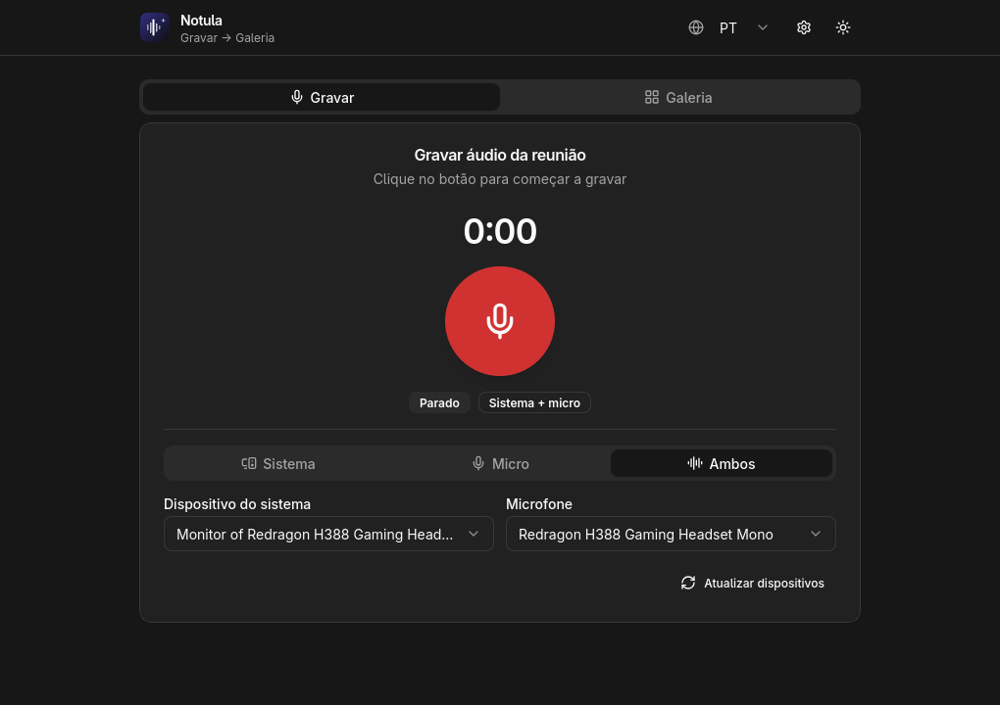

<p align="center">
  
</p>

<h1 align="center">Notula</h1>

<p align="center">
  Meeting notes in 2 clicks — record, transcribe with speakers, summarize.
</p>

<p align="center">
  
  
  
  
  
</p>

Desktop app (Tauri + Rust + React) that turns meetings into notes: capture system
audio and microphone, transcribe with **speaker diarization**, and generate
**key points, decisions, action items and a summary** — everything linked to its
recording and stored locally.

## Screenshots

<p align="center">
  
</p>

## Features

- 🎙️ **Record** system audio, microphone, or both mixed (16 kHz mono WAV)
- 🗣️ **Speaker diarization** — transcript labeled `Falante 1: …`, `Falante 2: …`
- ✨ **AI summaries** in Markdown, in English or Portuguese (PT-BR headers included)
- 🖼️ **Gallery** of past tasks: audio player, transcript and summary per task,
  with rename, delete, re-transcribe and re-summarize
- 📝 Name recordings up front, rename them later
- 🌙 Light/dark mode, UI in English and Brazilian Portuguese

## How it works

Two tabs, no realtime (by design — record first, process after):

1. **Gravar** — pick sources, click the big red button, name the recording.
2. **Galeria** — open a task to play it, transcribe it, and generate its summary.

Each recording lives in the app data dir with sidecars that link everything
together: `meeting.wav` + `meeting.txt` (transcript) + `meeting.md` (summary).

| Step | Model (Cloudflare Workers AI) | Approx. cost |
|---|---|---|
| Transcribe + diarization | `xai/grok-stt` | ~$0.10 / hour of audio |
| Summary | `@cf/meta/llama-3.1-8b-instruct-fast` | fractions of a cent |

## Requirements

- **Linux**: PipeWire or PulseAudio, plus `ffmpeg` and `pactl`.
- **Windows**: `winget install ffmpeg` (on PATH). Mic works out of the box;
  system-audio capture needs **Stereo Mix** enabled or a virtual cable
  ([VB-CABLE](https://vb-audio.com/Cable/)) — a Windows limitation, explained
  in-app.
- A Cloudflare account with Workers AI + an API token
  (Dashboard → My Profile → API Tokens → “Create Workers AI token”).

## Quickstart

```bash
npm install
npm run tauri dev
```

Build installers (`.msi`/`.exe` on Windows, `.AppImage`/`.deb` on Linux):

```bash
npm run tauri build
```

Pushing to `main` also builds everything via `.github/workflows/build.yml`.

## Configure

Gear menu (top right) → paste Account ID + API Token. Models, output language
and transcription language are adjustable there; settings persist locally and
deprecated model ids auto-migrate.

## Tech

- Backend: Tauri 2 + Rust (`ffmpeg` for capture, `reqwest` for Workers AI)
- Frontend: React 19 + Vite, shadcn-style UI (Radix + Tailwind), `sonner` toasts
- Playback: WebAudio (sample-accurate, works around WebKitGTK media quirks)
